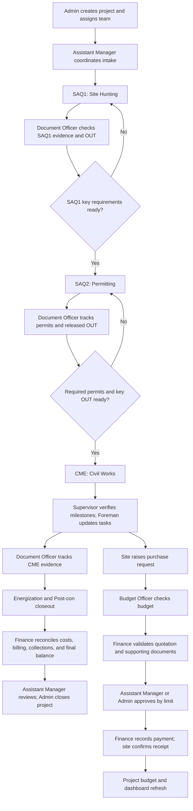

# Project Workflow: Setup to Closeout

This is the shared product reference for who handles a project, how documents and money move, and what the project dashboard should show. It describes the intended end-to-end workflow and calls out where the current frontend demo still needs wiring.

## Roles and ownership

| Role | Project responsibility |
| --- | --- |
| Admin | Creates the project, assigns the team and project code, sets approval limits, and gives final or exception approval. |
| Assistant Manager | Coordinates the project from intake through closeout, follows up on blockers, reviews progress, and approves within delegated limits. This is the project-coordinator role because the app has no separate Project Manager or Site Acquisition role yet. |
| Document Officer | Sets up the right checklist template, links evidence to checklist items, checks completeness, returns incomplete submissions, and records released OUT items. |
| Site Supervisor | Owns the site plan and verified physical progress; manages milestones, task assignments, delivery follow-up, attendance review, and incident escalation. |
| Foreman | Reports daily task completion and site needs, and submits material or cash-advance requests against the project. |
| Budget Officer | Maintains project budget lines and checks that requests fit the approved budget before financial approval. |
| Finance | Checks supporting financial documents, validates costs and payment details, records expenses, invoices, payments, and collections, and keeps the project ledger current. |
| Client | Receives read-only project progress, approved documents shared with them, and billing information. |
| HR / Asset Officer | Supports assigned workforce, payroll, equipment, and transfer records that are associated with the project. |

Every transaction and document must use the same stable project code (for example, `P-001`) so the project page can bring the records together.

## End-to-end flow

## Stage checklist

1. **Project setup:** Admin records the project code, client, location, project type, approved budget, and assigned team. Assistant Manager confirms the owner and the first target dates. The project type selects the applicable SAQ1, SAQ2, CME, COLOC, or RELOC template.
2. **SAQ1 - Site Hunting:** The assigned project team gathers the client nominal point, pre-validation, site photos, SAQR/TSSR, social-awareness evidence, CD, property documents, and the related MOC or Barangay Clearance OUT. The Document Officer checks the evidence and marks checklist status; the Assistant Manager follows up on missing information.
3. **SAQ2 - Permitting:** The team tracks property documents, lease agreement, BP forms, zoning and other permits, and the applicable CAAP/CNC/lot-segregation/SBT/DDD items and OUTs. The Document Officer records what is complete, pending, returned, or released. An external permit is not treated as issued until its evidence is recorded.
4. **CME - Civil Works:** Once site and permit prerequisites are cleared, the Site Supervisor owns the construction milestones and verified physical progress. The Foreman updates assigned tasks and reports materials or site blockers. The Document Officer tracks CME records such as DP, logbook, NTP, insurance, tower foundation, mill certificate, rebar testing, excavation checklist, and RFTI evidence.
5. **Energization:** The Supervisor coordinates installation readiness. The Document Officer tracks the client MOA, CFEI, COO, application, materials, job order, and Installation OUT required by the project's template.
6. **SAQ2 - Post-con and handover:** The team tracks the site tax declaration, LGU COC, warranty bond, FAC, and handover OUT. The Assistant Manager confirms closeout items with the client and site team.
7. **Financial closeout:** Finance reconciles approved costs and receipts, project expenses, invoices, collections, and any outstanding balance. The Assistant Manager reviews the closeout; Admin marks the project complete after required operational and financial closeout checks.

Checklist names vary by project type and approved template. The Document Officer must use that project's actual template rather than assume every project needs every item above.

## Purchase and finance approval flow

1. Foreman or Site Supervisor submits a request with the project code, item, quantity, supplier/quotation, amount, need date, and reason.
2. Budget Officer checks the available category budget and flags an over-budget request or requests a budget change.
3. Finance validates the quotation, tax/invoice details, supporting documents, and payment details. Finance records its review as a finance check, not as proof that the goods were received or the payment was released.
4. Assistant Manager or Admin gives the approval required by the configured amount/authority limit. A rejected request returns to the requester with a reason.
5. After approval, purchasing proceeds. Site confirms received quantity and condition; Finance records the invoice/payment and links it to the approved request.
6. The project dashboard updates commitments, actual spend, remaining budget, and audit history. A pending or rejected request must not count as paid actual spend.

Document approval is separate from financial approval: the Document Officer validates evidence and checklist completeness; Finance validates financial records; the authorized manager approves spending.

## What each dashboard should show

- **Project / Assistant Manager:** stage, physical milestones, checklist readiness, blockers, overdue tasks, open incidents, budget summary, and pending approvals.
- **Documents:** project-specific checklist completion, key documents still pending, OUT status, returned files, expiry dates, and who last updated each item.
- **Site Supervisor / Foreman:** assigned tasks, verified milestones, attendance, deliveries, incidents, and material requests for their project.
- **Budget Officer / Finance:** project budget versus committed and actual spend, pending requests, approval state, invoices, payments, collections, and outstanding balance.
- **Admin:** cross-project health, delayed projects, unresolved approvals, risks, and audit history.

Physical construction progress and document readiness are different measures. Show both separately; do not calculate physical progress from checklist completion. Physical progress should be calculated from approved milestone weights and supervisor-verified completion. Checklist progress should come from the project's checklist records.

## Current frontend-demo status and required wiring

The app already has project records, SAQ1/SAQ2/CME-oriented checklist templates, Site Documents, milestones, tasks, budgets, expenses, purchases, approvals, billing, and payments. The project code is the intended link between these records.

The following end-to-end rules are still requirements to implement and verify; the current demo does not enforce all of them:

- Checklist completion and key OUT prerequisites do not yet gate the next project stage automatically.
- Physical progress is currently an average of progress records; it is not a weighted, approval-controlled milestone calculation, and it is independent of checklist readiness.
- A generic document upload is not automatically matched to the corresponding site-checklist item; the Document Officer must maintain the checklist record separately.
- Finance has billing, payments, expenses, and payroll screens, but does not currently have the Approvals menu. A finance review step and role-limited approval permissions must be added before the purchase flow above is usable end to end.
- The frontend stores records in browser localStorage and files in browser IndexedDB. Different users/devices do not share live records; production use needs a backend, server-side role checks, shared file storage, and audit-safe transitions.

Treat the steps above as the required product flow, and the list in this section as implementation work—not as claims that the demo already provides a production workflow.

### Delegated Finance summary access

Admin can grant a Documents Officer a **Finance (View Only)** sidebar page for all projects or one selected project from Users & Roles. It contains only project-level budget, spend, billing, collected, outstanding, and overdue totals. It does not expose invoice/payment rows, payroll, bank details, edits, or approvals. This is a frontend-demo permission stored with the demo user; production must enforce the same project scope with backend authorization and database row-level security.